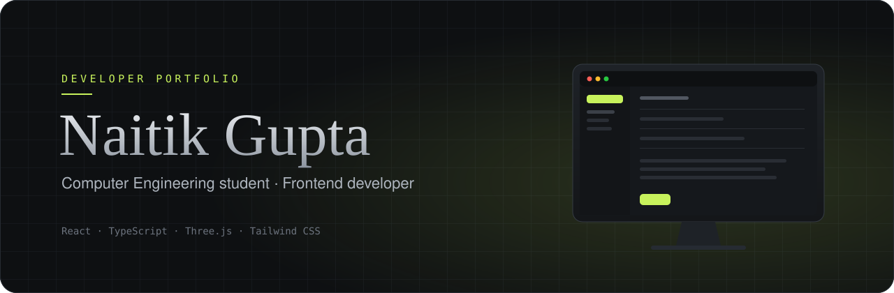

<p align="center">
  
</p>

<p align="center">
  <a href="https://creatorofc-gif.github.io/Naitik_newestportfolio/"></a>
  <a href="https://github.com/creatorofC-gif/Naitik_newestportfolio/actions/workflows/mobile-checks.yml"></a>
</p>

<p align="center">
  
  
  
  
  
  
  
</p>

<br />

An interactive, scroll-driven portfolio. Each section is its own small scene: you scroll, and the page performs.

<br />

## The site, section by section

| | Section | What happens |
|:--|:--|:--|
| `01` | **Hero** | A full-screen video with a terminal typing intro, moving as you scroll. |
| `02` | **Toolbox** | A 3D toolbox (Three.js) unlatches, opens its trays, and the camera dives inside to the skills. |
| `03` | **Projects** | A whiteboard where a marker writes each project live, then an eraser wipes it for the next. |
| `04` | **Experience** | A git branch you walk along with a voxel character. Each role is a commit. |
| `05` | **Contact** | A desktop computer rises into view and powers on into a working mail client. |

On phones and tablets the heavy motion steps aside: the contact form becomes a plain, static
form, so typing and the on-screen keyboard behave normally.

<br />

## Built with

<table>
  <tr>
    <td><b>Interface</b></td>
    <td>React 19, TypeScript, Tailwind CSS</td>
  </tr>
  <tr>
    <td><b>Motion</b></td>
    <td>Framer Motion, Lenis smooth scrolling, a shared scroll-scene loop (<code>src/utils/scrollScene.ts</code>)</td>
  </tr>
  <tr>
    <td><b>3D</b></td>
    <td>Three.js for the toolbox scene</td>
  </tr>
  <tr>
    <td><b>Content</b></td>
    <td>Generated from the resume PDF at build time (pdf.js)</td>
  </tr>
  <tr>
    <td><b>Contact</b></td>
    <td>Google Apps Script backend writing to a Google Sheet</td>
  </tr>
  <tr>
    <td><b>Quality</b></td>
    <td>Playwright on iPhone, Pixel and iPad; Node test runner; oxlint</td>
  </tr>
</table>

<br />

## Run it locally

```bash
npm install
npm run dev          # http://localhost:5173/Naitik_newestportfolio/
npm run build        # production build in dist/
npm run test:unit    # resume parser, contact-form rules, date labels
npm run test:mobile  # iPhone / Pixel / iPad checks (needs Playwright browsers)
```

<br />

## How the content stays current

> The resume is the single source of truth.

Most content comes from **the resume PDF in `src/data/`** (keep exactly one PDF there).
Before every `dev` and `build`, `tools/parse-resume.mjs` reads it and fills in education,
internships, projects and skills. The site's **View Resume** button serves the same PDF.

Replace the PDF, push, and the site updates. If the resume's layout changes so much that it
can't be read, the build stops with an explanation instead of publishing wrong data.

Content that isn't on the resume (commit messages, project subtitles, skill descriptions)
lives in the *Site-only extras* section at the top of `src/data/profileData.ts`.

<br />

## Contact form

Messages go to a Google Apps Script web app (`tools/contact-backend.gs`). It saves each one
to a Google Sheet and sends an email notification. Setup steps are at the top of that file.

The web app's URL is the `ENDPOINT` constant in `src/components/ContactDirect.tsx`. It is
public by nature, and the backend repeats every spam check on its side. If you create a new
deployment, paste its URL there.

<br />

## Deploy

```
push to main  ──▶  mobile & unit checks  ──▶  build  ──▶  GitHub Pages
```

Pushing to `main` runs the checks. If they pass, GitHub Actions builds the site and publishes
it to GitHub Pages (Settings → Pages → Source: GitHub Actions). The repo also includes a
`vercel.json`, so the same build can be deployed on Vercel.

<br />

<p align="center">
  <sub>Designed and built by <a href="https://creatorofc-gif.github.io/Naitik_newestportfolio/">Naitik Gupta</a></sub>
</p>
